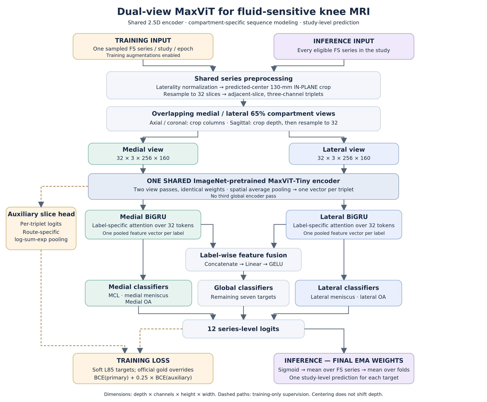

# L185 dual-view MaxViT FS router

Ian's five-fold `l185conf1` component of the final ensemble (original runs
exp-0765–0769). This is the **two-view, rectangular, ordinary-EMA** model,
not the earlier three-view router or Switch-EMA experiments. It reuses this
repository's `assets/data/labels_1_85.csv` and `frozen_training_metadata.csv`;
no duplicate label tables, private downloads, reports, or trained weights are
committed here. The twelve target probabilities and all five fold assignments
were checked against the original training inputs. `conf_*` columns were never
used. L85 already includes the upstream label blends described in the root
README; this component adds **no further OOF fusion or loss weighting**.

## Architecture and preprocessing



We used a 2.5D dual-view MaxViT-Tiny model operating on fluid-sensitive (FS)
MRI series. Following laterality normalization and a predicted-center, 130-mm
in-plane crop, each series was resampled to 32 slices with adjacent slices
stacked as three-channel inputs. Overlapping medial and lateral views, each
covering 65% of the knee and resized to 256×160 pixels, were processed by a
shared ImageNet-pretrained encoder. Separate bidirectional GRUs (256 hidden
units per direction) and label-specific attention pooled the slice features.
MCL, medial meniscus and medial OA use the medial features; lateral meniscus
and lateral OA use the lateral features. The other seven targets use learned
label-wise fusion of both views (concatenation, linear projection, GELU),
avoiding a third global encoder pass. Soft-target BCE is supplemented by a
shared slice classifier with route-specific log-sum-exp pooling and loss weight
0.25. Final EMA predictions are averaged across FS series and then fold models.

Important details preserved by the frozen source:

- DICOM slices are geometry-ordered. Intensity normalization uses whole-series
  percentiles **1 and 99**, scaled/rounded to uint8 PNGs. Do not reuse the other
  components' 0.5/99.5 caches or physical 3-mm triplet convention.
- The supplied metadata provides each training series' center, spacing and
  canonical medial-to-lateral direction. The locator's z coordinate is **not**
  used: this is in-plane centering, not depth centering. Native out-of-bounds
  in-plane crops are zero padded.
- Full native depth is resampled to 32 (linear when reducing, nearest when
  increasing). Channels are adjacent resampled slices with replicated endpoints.
- Axial/coronal compartment views take the first/last 166 columns of the
  256-square input. Sagittal views take the first/last 21 **triplet positions**,
  resample each back to 32 with trilinear interpolation, and preserve the full
  centered in-plane FOV. Both views resize to 256×160 using bilinear interpolation.
- Both views share encoder weights but use separate GRUs/attention layers.
  There is no joint multi-series training: labels supervise a single series;
  averaging over series happens in validation/inference.

## Exact training recipe

| Parameter | Setting |
|---|---|
| Backbone | `maxvit_rmlp_tiny_rw_256.sw_in1k`, ImageNet-1k pretrained |
| Inputs per view | 32 triplets × 3 channels × 256 × 160 |
| Training sampling | One randomly sampled FS series per study per epoch |
| Validation | All eligible FS series; average probabilities per study |
| Folds | Bundled L85/Parag folds; 58 gold studies rotate normally |
| Epochs / precision | 20 / BF16 mixed precision |
| Batch / accumulation | 16 per single GPU / 1 (none) |
| Encoder chunk size | **256 triplets**, preserved in training |
| Optimizer | AdamW, LR 2e-4, weight decay 0.01 |
| Schedule | Linear warmup from 0 for 10%, then cosine to 1e-6 |
| Optimizer updates | 220 per epoch, 4,400 total, 440 warmup; corrected scheduler |
| EMA | Ordinary EMA 0.99 with warmup; includes buffers; Switch EMA off |
| Dropout / auxiliary BCE | 0.2 / 0.25 |
| Augmentation | Probability 0.8; ±10° rotation, scale 0.9–1.1, ±5% translation |
| Intensity augmentation | Gamma 0.85–1.15, contrast 0.9–1.1, brightness ±0.05, noise SD up to 0.02 |
| Flips | No random flips or depth reversal (anatomical canonicalization is deterministic) |
| Seed | 20260811 + fold |

The sampler drops the final incomplete batch (5–6 shuffled studies per epoch).
Gold targets are replaced with official binary annotations **in both train and
validation**. There are no noncompetition auxiliary targets: the slice head
predicts the same twelve targets. Validation reports gold AUCs and combined
AUCs with non-gold targets binarized at ≥0.2/0.5/0.8. Gold targets are not
thresholded. Final EMA checkpoints, not best-on-gold checkpoints, were deployed.
Pooled held-out gold evaluation contains 58 unique studies; do not average all
five models on those studies and call that OOF.

## Environment

Use the repository's documented container and base requirements. Add the
isolated trainer dependencies (these do not reinstall torch/torchvision):

```bash
python -m pip install -r maxvit/requirements.txt
python -m pip check
export OMP_NUM_THREADS=2 OPENBLAS_NUM_THREADS=2
python -m unittest discover -s tests -p 'test_maxvit.py' -v
```

These tests skip when the optional MaxViT dependencies are absent, preserving
the root test command for users working only on the other model components.

The original runs used Python 3.11, torch 2.6.0+cu124, torchvision 0.21.0+cu124,
and timm 1.0.27. The published source is isolated under `maxvit/src/skp` to avoid
changing `lab/` or installing a global `skp` package. Numerical equality after
retraining with a different CUDA/PyTorch version is not guaranteed. See
[VALIDATION.md](VALIDATION.md) for the actual tested environments and limits.

## End-to-end training

Run from the repository root. First download the official competition data
using the root README. The defaults are:

```text
raw:      assets/data/rsna-knee-abnormality-detection/
PNGs:     assets/data/maxvit_png/
metadata: assets/data/maxvit/
outputs:  outputs/maxvit/
```

Optional absolute-path overrides: `KNEE_DATA_ROOT`, `KNEE_PNG_ROOT`,
`MAXVIT_METADATA`, `KNEE_SAVE_DIR`. Export them consistently for every command.
Prepared manifests pin local paths/hashes, so regenerate preparation in a new
metadata directory if relocating inputs. Existing prepared directories are
never overwritten automatically.

```bash
# Generate folds, soft-label records and exact gold-override targets locally.
python -m maxvit.cli prepare
# Convert all training DICOMs with the original per-series PNG converter.
# Resumable conversion; malformed series are recorded rather than hidden.
python -m maxvit.cli convert --workers 8
# Download and hash-check the pinned ImageNet initialization (not task weights).
python -m maxvit.cli download
# Decode actual samples in all three planes and check folds/4400-step schedule.
python -m maxvit.cli check --fold 0
```

Training requires a reachable MLflow HTTP server. The training environment
installs `mlflow-skinny` only: full MLflow 3.13 requires pandas&lt;3 and would
conflict with the repository's pandas 3.0.6. Use an existing server, or start
one in a **separate environment** in another terminal:

```bash
mkdir -p outputs
python -m venv outputs/mlflow-venv
outputs/mlflow-venv/bin/pip install mlflow==3.13.0
outputs/mlflow-venv/bin/mlflow server --host 127.0.0.1 --port 5001 \
  --backend-store-uri sqlite:///outputs/maxvit-mlflow.db \
  --default-artifact-root ./outputs/maxvit-mlflow-artifacts
```

Then train each fold on **one GPU**, including the last fold:

```bash
export MLFLOW_TRACKING_URI=http://127.0.0.1:5001
export CUDA_VISIBLE_DEVICES=0
for fold in 0 1 2 3 4; do
  MASTER_PORT=29730 python -m maxvit.cli train --fold "$fold" --run-id "l185-f$fold"
done
```

To run folds concurrently, use separate terminals, distinct GPU IDs/run IDs and
distinct `MASTER_PORT` values. The original batch/chunk profile used a 48-GB
RTX A6000; **24-GB compatibility is not claimed**. Do not silently reduce the
256 encoder chunk if reproducing this recipe: chunking affects training-time
BatchNorm. No full training jobs are launched by tests or preparation.

The original trainer writes console logs, MLflow metrics, best and last
checkpoints, and per-validation OOF files. Launcher records pin the dataset
manifest and recipe. Checkpoints retain both `state_dict` (EMA) and
`raw_training_state_dict` (ordinary training weights). The wrapper refuses reused
launch IDs; it does not silently resume or overwrite a run.

## Export and OOF pooling

```bash
python -m maxvit.cli export \
  --checkpoint outputs/maxvit/l185_public/l185-f0/fold0/checkpoints/last.ckpt \
  --output outputs/maxvit/export/weights/last-fold0.pt
```

Repeat for folds 1–4. Exports require epoch index 19 and EMA metadata, strictly
load into the original architecture, and retain all parameters and buffers.
Only load trusted checkpoints: full training checkpoints use PyTorch pickle.
The resulting `{'state_dict': ...}` files use the original deployment key layout;
the inference notebook's existing `l185conf1` model loader can consume them.
This folder intentionally does not replace the other components' inference
or submission orchestration. Existing inference code handles center/laterality
model prediction for new studies; frozen metadata here is for training studies only.

OOFs are already saved during every validation, so no separate GPU inference
is necessary. After all folds finish:

```bash
python -m maxvit.cli pool \
  --oof-dirs outputs/maxvit/l185_public/l185-f0/fold0/oof/epoch=019-step=0004400 \
             outputs/maxvit/l185_public/l185-f1/fold1/oof/epoch=019-step=0004400 \
             outputs/maxvit/l185_public/l185-f2/fold2/oof/epoch=019-step=0004400 \
             outputs/maxvit/l185_public/l185-f3/fold3/oof/epoch=019-step=0004400 \
             outputs/maxvit/l185_public/l185-f4/fold4/oof/epoch=019-step=0004400 \
  --output outputs/maxvit/final_ema_oof.csv
```

Pooling validates fold identity, unique coverage, epoch/step, EMA selection,
class order, data provenance and artifact hashes. Each study must appear exactly
once in its held-out fold, not as an ensemble over in-sample models.

## Provenance and limitations

`source_manifest.json` records the original source hashes and run IDs. The
model, dataset, sampler, scheduler, EMA callbacks, metrics and trainer are
copied from SKPv2 without rewriting their numerical operations. The DICOM
converter's two default paths are the only edits to copied Python code.
The portable config/CLI adapts data locations and generates target records
from the already-public tables. No historical Gemini labels are needed.

Training centers use the original manual/OOF helper policy. These helper folds
are not a fully nested CV within each finding-model fold. Reusing the frozen
geometry reproduces that policy; it is not a claim of nested helper validation.
The provided metadata and label tables are identical to, or floating-point CSV
roundoff-equivalent to, the inputs consumed in the original runs.

The included SKPv2 code is MIT-licensed; see [LICENSE](LICENSE). EMA source
retains its timm attribution. Architecture diagram: [editable SVG](figures/dual_view_maxvit_fs_router.svg).
